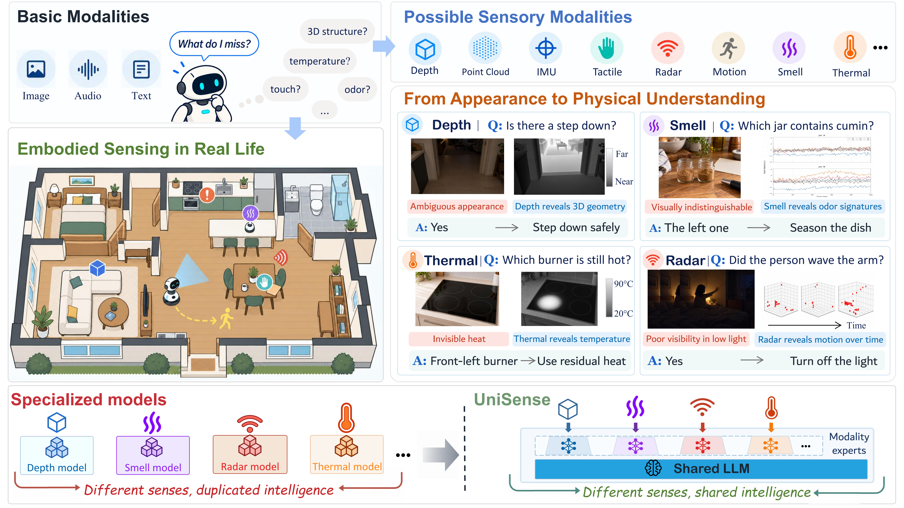

<div align="center">

<h1>Beyond Omni: A Unified MLLM for Embodied Sensory Understanding</h1>

<br>

<!-- [](#abstract) -->
<!-- [](#citation)

 -->

**A unified multimodal language model for understanding the physical world through embodied senses.**

</div>

<p align="center">
  
</p>

## Abstract

> Broad embodied understanding requires diverse physical evidence while drawing on shared knowledge and reasoning.

Pretrained multimodal large language models offer strong understanding and reasoning capabilities, but their perception of the physical world remains largely limited to basic modalities such as vision and audio. We introduce **UniSense**, a unified embodied MLLM framework that supports diverse physical sensory modalities within a shared multimodal architecture. Its two-stage training process first **aligns sensory representations with language**, establishing a language-accessible interface, and then **tunes modality-specific experts** within the shared LLM for specialized sensory processing.

To support broad sensory learning, we curate **UniSense-1M**, a corpus of **1M samples across 8 sensory modalities**. Evaluation on **12 benchmarks** spanning depth, point cloud, IMU, tactile, thermal, radar, motion, and smell demonstrates strong performance against generalist and specialized models.

## 📢 News

- 🗓️ **2026.10** — The training code is available

## Installation

Clone the repository and install the dependencies:

```bash
git clone https://github.com/Shiyun-x/Unisense.git
cd Unisense

pip install -r requirements.txt
```

## Model

<p align="center">
  
  <br>
  <sub><em>A shared backbone connects different senses; alignment and experts provide modality-specific adaptation.</em></sub>
</p>

| Model | Weights |
| :--- | :---: |
| **UniSense-2B** | Coming soon |
| **UniSense-9B** | Coming soon |

### Pretrained Models

For multimodal initialization, download [Qwen3.5-2B](https://huggingface.co/Qwen/Qwen3.5-2B) or [Qwen3.5-9B](https://huggingface.co/Qwen/Qwen3.5-9B) as the vision-language backbone and [Whisper large-v3-turbo](https://huggingface.co/openai/whisper-large-v3-turbo) as the speech encoder from their official Hugging Face repositories. Export Qwen's language and vision branches, including their configurations and tokenizer/image-processor files, into the corresponding `model_zoo/LLM/` and `model_zoo/vision/` directories before training.

## Data

**UniSense-1M** (coming soon) contains 1M training samples across eight embodied sensory modalities.

| Modality | Training data |
| :--- | :--- |
| **Depth** | SpatialQA · SPAR · CAVQA |
| **Point cloud** | CLEVR3D · ScanQA · SceneVerse · MV-ScanQA |
| **IMU** | LLaSA instruction and activity-classification data |
| **Tactile** | VTV · Octopi |
| **Radar** | MMFi-based captions, question answering, and activity data |
| **Motion** | QuAnTS instruction data |
| **Smell** | Multi-channel gas-sensor captions and question answering |
| **Thermal** | IRTD · MSPR · Infrared instruction data |

### Directory Structure

Place instruction annotations in `data/`, sensor files in `dataset/`, and model assets in `model_zoo/` and `work_dir/base_model/`. Follow the dataset paths registered in [unisense/train/data_settings.py](unisense/train/data_settings.py).

```text
Unisense/
├── unisense/                        # Model, preprocessing, and trainer
├── scripts/                         # MoE and DeepSpeed configurations
│   └── train/
│       ├── merge_pretrain.py
│       ├── pretrain/
│       │   ├── run_speech_projector_pretrain.sh
│       │   └── run_multimodal_pretrain.sh
│       ├── run_sensory_representation_alignment.sh
│       └── run_modality_specific_expert_tuning.sh
├── data/                            # JSON / JSONL instruction annotations
├── dataset/                         # Raw and preprocessed sensor data
├── model_zoo/
│   ├── LLM/
│   │   └── Unisense_Qwen35_9B_LLM/
│   ├── vision/
│   │   └── Unisense_Qwen35_9B_ViT/
│   └── audio/
│       └── whisper-large-v3-turbo/
├── work_dir/
│   └── base_model/
│       └── Unisense_qwen35_9B/
├── requirements.txt
└── README.md
```

The Python package is named `unisense`. Launchers use `data/Unisense_SFT/multi_modality_speech/unisense_multimodal.json` for the base multimodal instruction data. Local asset paths can be overridden with `BASE_MODEL_PATH`, `VISION_TOWER_PATH`, and `DATA_PATH`.

## Training

Prepare the models and data before training. Multimodal initialization is followed by sensory representation alignment and modality-specific expert tuning.

**(1) Multimodal initialization:**

```bash
bash scripts/train/pretrain/run_speech_projector_pretrain.sh
bash scripts/train/pretrain/run_multimodal_pretrain.sh
python scripts/train/merge_pretrain.py
```

The merge command folds the multimodal LoRA adapter and the pretrained speech
projector into `work_dir/base_model/Unisense_qwen35_9B`. This step is required:
both sensory representation alignment and modality-specific expert tuning use
that merged checkpoint as their default base model.

**(2) Sensory representation alignment:**

```bash
bash scripts/train/run_sensory_representation_alignment.sh
```

**(3) Modality-specific expert tuning**:

```bash
bash scripts/train/run_modality_specific_expert_tuning.sh
```

## Evaluation

Evaluation code, benchmark data, and detailed results for embodied sensory understanding and general multimodal tasks are coming soon.

## Citation

If you find this work useful, please cite our [paper](https://arxiv.org/abs/2610.26751):

```bibtex
@article{xiong2026beyond,
  title   = {Beyond Omni: A Unified MLLM for Embodied Sensory Understanding},
  author  = {Xiong, Shiyun and Wu, Dongming and Sun, Peiwen and Yang, Bokang and Wang, Jiaxu and Sun, Xiaolou and Wen, Mingxing and Yue, Xiangyu},
  journal = {arXiv preprint arXiv:2610.26751},
  year    = {2026}
}
```

<p align="center">
  <a href="#"><strong>↑ Back to top</strong></a>
</p>

<!-- TODO: Add paper / project-page URLs to the header. -->
